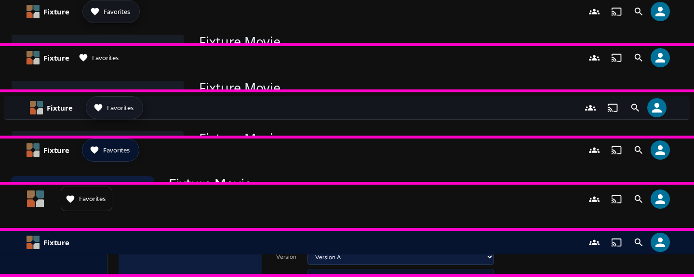
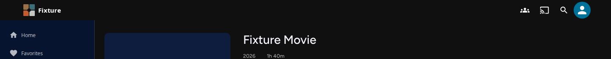
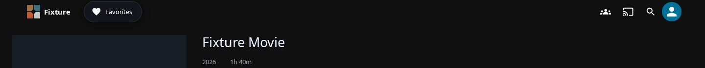

# THEME-B1: header recipe captures

After is B1 (`05d1e3c1f3`). Before is A2 (`2f203a7a55`, its parent), for the official themes only. Real production bundle, Item Details page, server-free fixture, 1440×900 and 390×844. Each capture is the top 140 px: the bar at rest, then after scrolling.

*Strip, top to bottom: Glass as shipped; Glass + `nav.style: underline`; Glass + floating glass bar with hairline; Classic in topbar + `nav.style: floating`; Classic + `spacious`, `segmented`, mark-only large brand; Classic scrolled.*

## Measured

| Variant | Width | Material rest→scrolled | Destinations | Smallest target (px) | Bar box |
| --- | --- | --- | --- | --- | --- |
| `classic` | desktop | transparent→surface | — | 44 | 1440×48 at 0,0 |
| `classic` | mobile | transparent→surface | — | 44 | 390×48 at 0,0 |
| `glass` | desktop | transparent→transparent | floating | 44 | 1440×48 at 0,0 |
| `glass` | mobile | transparent→surface | — | 44 | 390×48 at 0,0 |
| `glass-underline` | desktop | transparent→transparent | underline | 44 | 1440×48 at 0,0 |
| `glass-underline` | mobile | transparent→surface | — | 44 | 390×48 at 0,0 |
| `classic-topbar-floating-nav` | desktop | transparent→surface | floating | 44 | 1440×48 at 0,0 |
| `classic-topbar-floating-nav` | mobile | transparent→surface | — | 44 | 390×48 at 0,0 |
| `glass-floating-bar` | desktop | glass→glass | floating | 44 | 1424×49 at 8,8 |
| `glass-floating-bar` | mobile | glass→glass | — | 44 | 390×49 at 0,0 |
| `classic-spacious-segmented-mark` | desktop | transparent→surface | segmented | 44 | 1440×60 at 0,0 |
| `classic-spacious-segmented-mark` | mobile | transparent→surface | — | 44 | 390×60 at 0,0 |

## The documented change to the default bar: target sizes

| Theme | Width | Smallest target before (A2) | After (B1) |
| --- | --- | --- | --- |
| classic | desktop | 40 | 44 |
| classic | mobile | 40 | 44 |
| glass | desktop | 35 | 44 |
| glass | mobile | 40 | 44 |

The destination links measured 35 px and the account button 40 px. Both are 44 px in the modern header now, and nothing else about the default bar changes: same material, same shadow, same height.

| | Before (A2) | After (B1) |
| --- | --- | --- |
| classic, desktop, at rest |  |  |
| glass, desktop, at rest |  |  |

Limits:
- On desktop the fixture page is too short to scroll, so "scrolled" equals "at rest" there, on the A2 build too.
- The floating bar falls back to a normal bar at 390 px, as specified.
- Raw measurements are in `head/*.json` and `base/*.json`.
