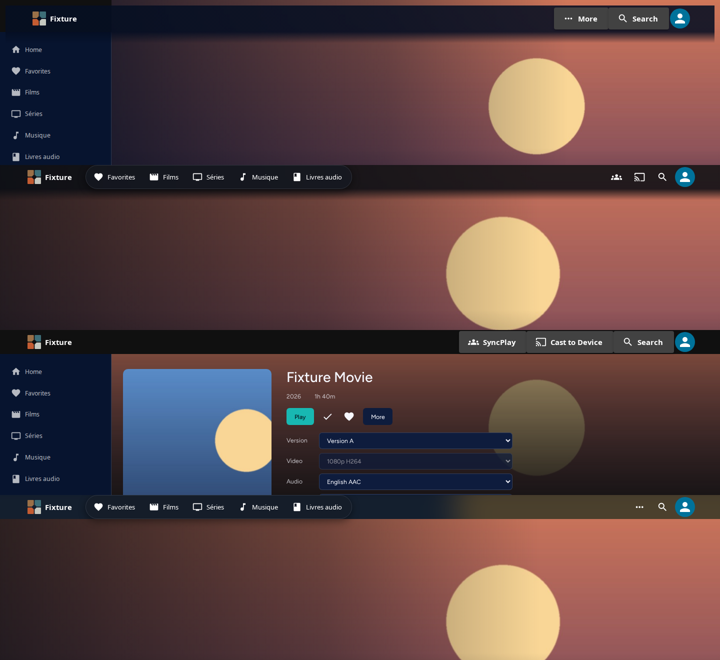
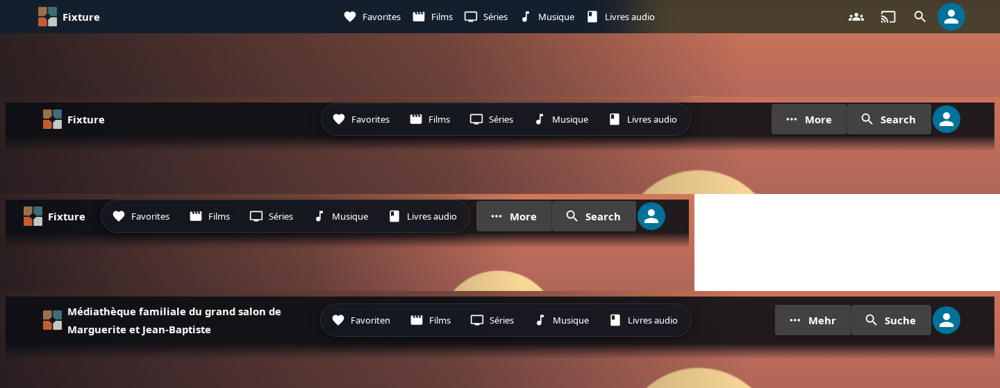
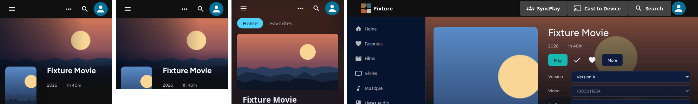
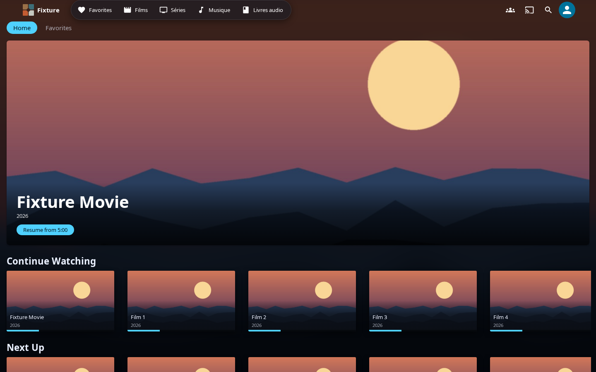
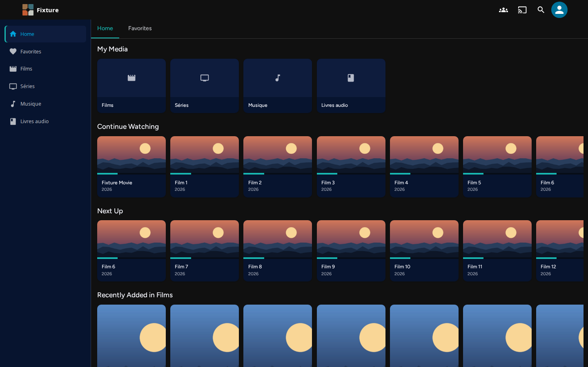
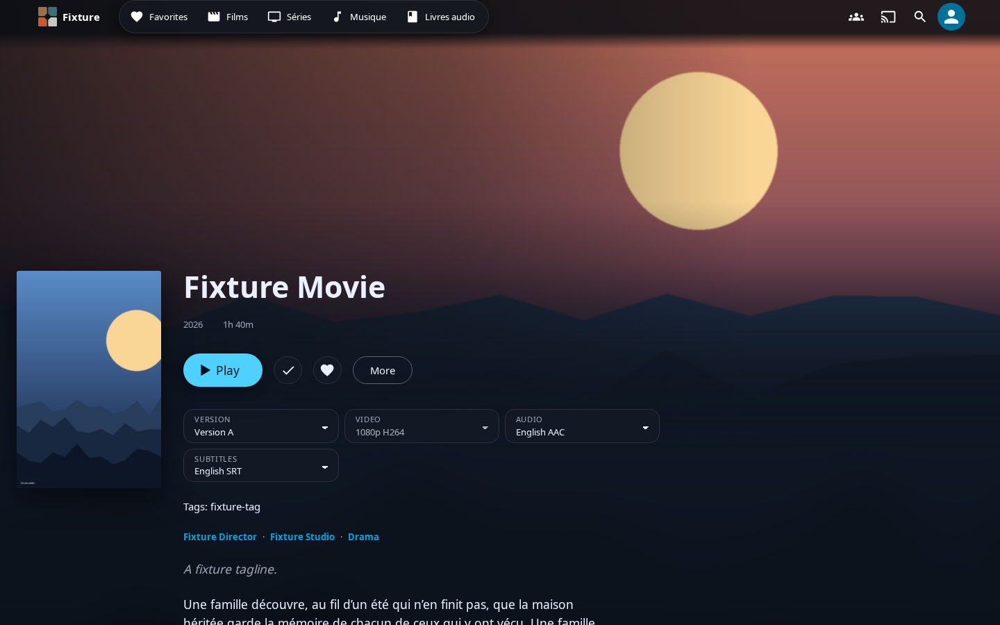
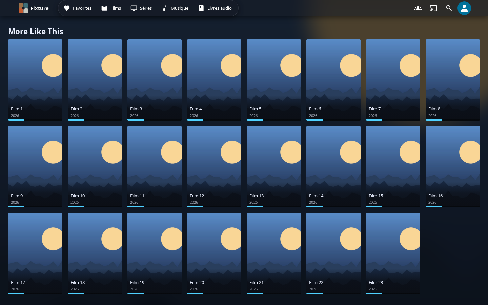
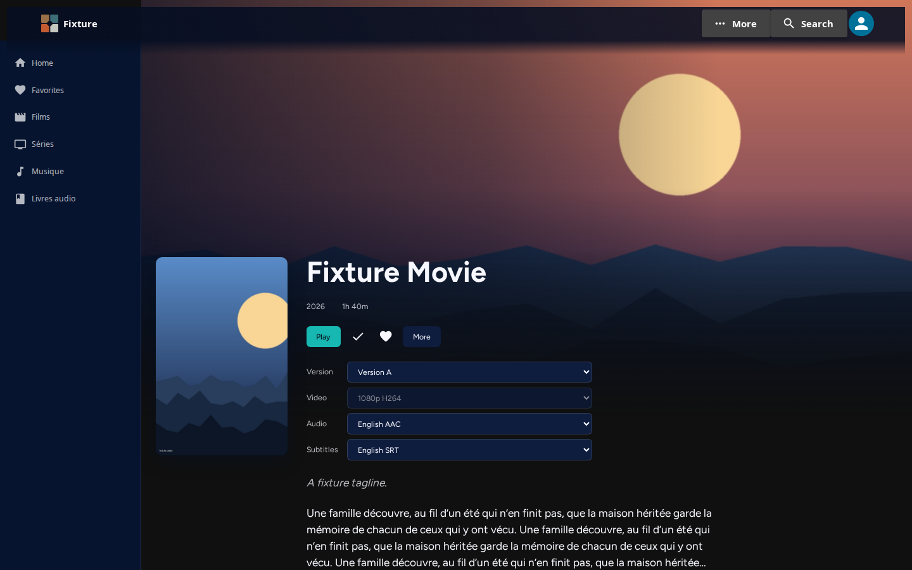
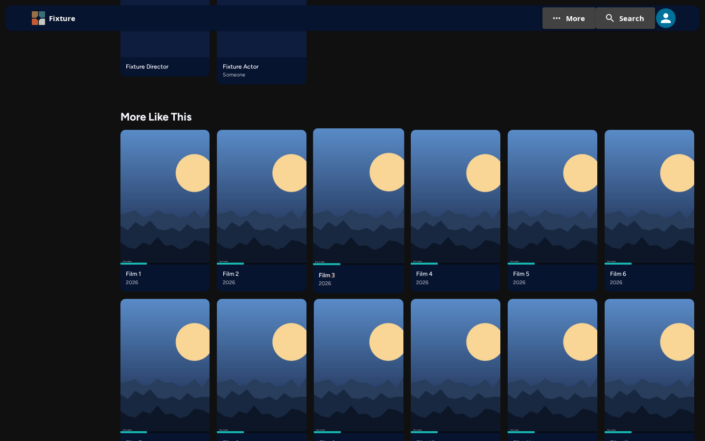

# THEME-B2 — header layout, actions, hero overlap

Production build, server-free fixture with artwork, a long Home (hero + four shelves) and a long Item
Details (long synopsis, 23 similar items). Every capture is from a page that really scrolled
(`scrollY` > 200 asserted; 1 178–1 400 px in practice). Spec: [`b2.browser.spec.ts`](b2.browser.spec.ts).

## Strips

Desktop 1440 px, at rest. Top to bottom: Classic floating + overlap + overflow + labels (sidebar shell,
so `centered` falls back to `start`), Glass + overlap, Classic labels, Glass overflow.

`centered` with the destinations in the bar (Glass): plain; floating + labels + overflow + overlap at 1440
and 1000 px; the same with a long server name in German.

Compact windows: 320 px and 320×256 (= 1280×1024 at 400 %), Glass overflow on a phone, Classic labels
at 1000 px. Compact draws `start` and icons only; no overlap.

## Default = `main`

`base/` is `main` (`e7a33187de`), `head/` this PR. The default Classic and Glass headers measure the
same on both builds (box, material at rest and scrolled, shadow, every control's position and size)
in all 26 default captures. Two long-content files differ only in which German strings had loaded at
capture time, not in geometry.

| | base | head |
| --- | --- | --- |
| Glass, Home |  |  |
| Classic, Home |  |  |

## Overlap

| Item Details, immersive, at rest | scrolled |
| --- | --- |
|  |  |
|  |  |

Home keeps its spacer even under `overlap: hero` ([`glass-overlap-desktop-home`](head/glass-overlap-desktop-home-rest.png)):
its tab strip, not the hero, opens the page.

## Keyboard and axe

`head/*-menus.txt`: account menu and "More" opened with Enter; choosing SyncPlay in "More" opens
SyncPlay's own menu; Escape returns focus to the button that opened it. axe 4.12.1 on the header, and
on the open menu with it: 0 violations at rest, with each menu open, and scrolled.
